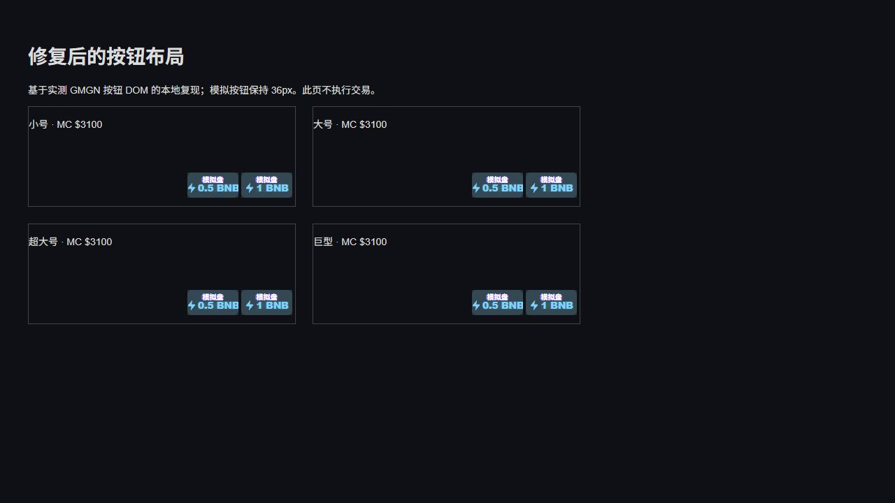

# GMGN 新盘、空 K 线及按钮尺寸验证

2026-10-14，Codex 内置浏览器，GMGN BSC 页面，已安装 Tango 模拟交易插件。只操作模拟交易，不执行原生买卖。

## 结论与验证边界

**状态：按用户要求暂停修复，先记录问题。** 实际页面复现两类问题：四种按钮尺寸都有原生文字占位导致的模拟按钮偏移；无 K 线且当前报价为零时，历史报价卖出可能被错误拒绝。已尝试修改代码并构建，但修改尚未提交，且审查发现未知供应量下仍存在分批卖出报价漂移，不能视为修复完成。

暂停前的验证：1017 项测试、安装包校验和构建通过；四种尺寸在内置浏览器的本地复现页面通过布局检查。这些结果没有覆盖全部审查发现，也没有证明已安装插件完成在线修复。

**已安装插件仍是旧副本。** 构建后刷新 GMGN，旧失败仍然出现；其按钮容器字体仍为 13px，而尝试修改的样式应为 0px。当前无法通过允许的浏览器操作重新加载该插件，因此不能宣称新代码已通过 GMGN 在线复测。恢复修复后，应先解决代码审查问题，再加载最终插件复测。

## 实际页面：显示尺寸切换

从“自定义 → 显示”的 `SizeButton` 选项依次切换小号、大号、超大号、巨型，核对选中项，并查看列表悬停按钮。原设置为超大号，检查后已恢复。

| 设置 | 模拟按钮高度 | 按钮相对宿主向右偏移 | 结果 |
| --- | --- | --- | --- |
| 小号 | 36px | 约 33.27px | 原生金额露出，按钮超出卡片边界 |
| 大号 | 36px | 约 33.27px | 同上 |
| 超大号 | 36px | 约 35.67px | 同上 |
| 巨型 | 36px | 约 33.27px | 同上 |

每张被检查卡片有两个模拟按钮，金额文字本身没有横向溢出，中心点点击检测能命中按钮；这些结果不能抵消其可见偏移与边缘裁切问题。当前设计将模拟按钮固定为 36px，GMGN 尺寸选项改变原生样式，不要求模拟按钮随之缩小。

原因：新版原生快捷买入容器本身就是 action host，其中保留 SVG 图标和原始金额文本；模拟按钮插入之后，这些兄弟内容仍占据 flex 空间。修复在接管状态下消除原生文字、图标、间隙及伪元素的占位，不删除原生节点，解除接管即可恢复原生内容。

使用实际观察到的按钮 DOM 和生产修复 CSS 构建本地复现页，在同一个内置浏览器检查四种尺寸。8 个按钮均为 36px，左右边界与宿主差值均为 0，全部位于卡片内，文字无溢出，中心点命中正确。该页面不执行交易，不能代替新版插件的在线复测。

## 实际页面：新盘与空 K 线

1. 烤斯克：捕捉时列表显示 2 秒，但实际点击前已为 18 秒，因此不算 2 秒买入。模拟买入 0.1 BNB 后，抽屉 50% 和 100% 卖出成功。余额依次为 9.9517 → 9.8517 → 9.8984 → 9.9451 BNB；半卖剩余成本 0.05 BNB，最后持仓为零。此时未打开详情页或 K 线。
2. 머슬캣 / Musclecat，地址 `0x42f34c0783068ddebf4f80fa57e6dced747cffff`：捕捉时 0 秒，点击前显示 1 秒，列表 MC $3.1K。模拟买入 0.1 BNB 的点击响应约 278ms，余额变为 9.8451 BNB。
3. 进入该代币详情页后，原生 Financial Chart iframe 的 body 为空：0 子元素、0 canvas。模拟面板显示持仓 2310.91 万枚、总买入 0.1 BNB、总卖出 0 BNB、入场市值 $3100、当前市值 $0。
4. 点击模拟 50% 卖出，提示“无法获得实时价格”；持仓、余额、总卖出均未变化。构建后仅刷新网页，仍复现旧副本的失败。

此轮实际快速操作仅验证了“创建 1 秒时买入”。详情页卖出发生在后续检查期间，不能称作 1 秒内完成买卖往返。

## 报价与横线修复

无图表的详情快照可包含 `priceUsd: 0`、`marketCapUsd: 0`、`priceObservedAt: 0`。原实现使用持仓历史价格，却保留当前零报价的无效时间，导致卖出验证失败。

当前未提交修改尝试把历史报价明确标记为模拟估值，并以 `TANGO_POSITION_HISTORY` 保留来源。新增回归测试使用实际 Engine 执行 50% 和重新解析后的 100% 卖出，验证数量、返款和最终余额，确切供应量路径已通过。但该测试没有走未知供应量的实际协调器规范化流程，因此不能据此断言所有分批卖出路径都安全。

### 审查新增问题：未知供应量的分批卖出报价漂移

代码审查复现：历史报价仍保留 `priceProvenance: FALLBACK_INITIAL_MARKET_CAP`。供应量未知时，`StateCoordinator.canonicalizeFallbackOrder()` 会将历史报价重新规范化为默认估值，并将来源改成 `TANGO_FALLBACK`。第一次部分卖出之后，剩余持仓失去历史报价来源；下一次重新解析可能从原历史价格 `0.0000031` 变为默认 `0.0000032`，在没有新观察的情况下制造价格变化和人为收益。

此问题来自代码审查的内存复现，不是实际 GMGN 在线成交复现。用户要求暂停时尚未修复；恢复后需要区分历史估值与初始兜底估值，并补充走实际协调器的未知供应量连续卖出测试。

历史估值不生成实时价格或市值横线。回归测试确认历史卖出没有虚构图表坐标。图表在此次实际页面检查中一直为空，无法验证原生 K 线出现后的横线补画、金额标签位置、隐藏或重放；这些仍待新版插件在线复测。列表真实市值产生的买入标记与历史估值不同，未取消其已有逻辑。

## 最终状态及证据

- 已恢复 GMGN 超大号设置、新创建买入金额 1，以及详情模拟面板折叠状态。
- 旧插件中仍保留本轮 Musclecat 模拟持仓，成本 0.1 BNB；因已复现卖出失败，未删除记录或修改余额。需要加载新版后完成平仓验证。
- 本轮开始前已有未提交改动已在此前提交处理；本轮代码、测试、构建产物及问题记录保留为未提交状态，没有继续修改产品代码或提交。
- 暂停前验证：`npm test` 1017/1017；`npm run check`；`npm run build`；`git diff --check`。未知供应量协调器问题不在这些通过测试的覆盖范围内。

证据目录：[rapid-size-2026-10-14](audit-evidence/rapid-size-2026-10-14/)。包括四种尺寸在线截图、空图表持仓/失败截图、原始 DOM 观察 JSON，以及修复后的本地复现页、截图和测量 JSON。

